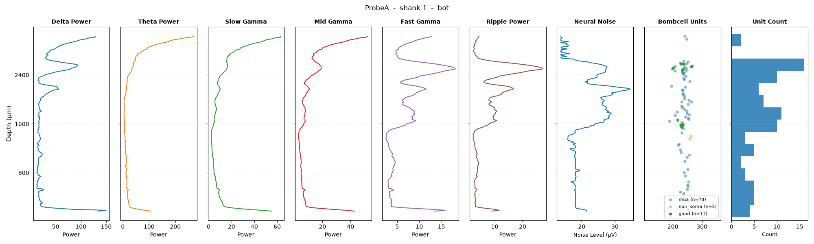

Repo to make plots for a ephys probe survey, which will make figures like this



First git clone the repo and move into it

```
git clone ...
cd ephys_survey
```

Then edit the `config.py` file.

Now you can run the big processing (spike sorting + saving LFP versions of the recording). Ideally do this on a powerful machine - might take an hour or so, even with a good GPU.

```
uv run make_big_stuff.py
```

Now create the data needed for plots, from the analyzer and lfp recordings

```
uv run make_plotting_data.py
```

And finally make the plots themselves

```
uv run make_plots.py
uv run make_aggregated_plots.py
uv run make_unit_quality_agg.py
```
